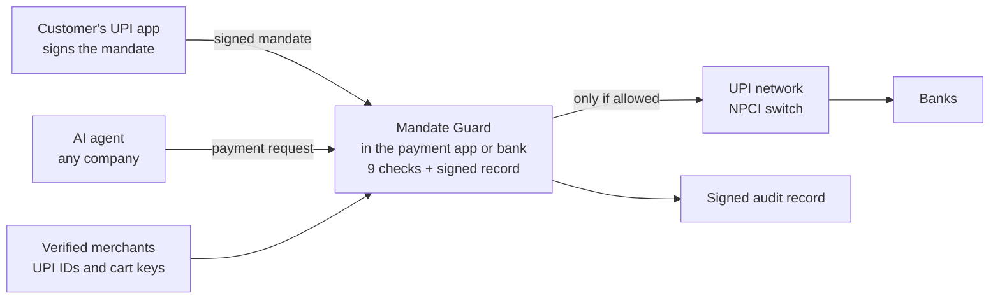

# Mandate Guard

**AI agents can now pay. Mandate Guard makes sure they pay only what you approved.**

A safety layer that sits between an AI agent and UPI, inside the payment app or bank. A payment goes through only if it fits a mandate the customer signed on their phone, goes to a verified merchant, and matches a cart that merchant signed.

Built for the **GIFT FutureLab Grand Challenge 2026–27** (theme: *From Technology to Trust*, focus area: Agentic AI).

- **Live guided demo:** https://yashg1836.github.io/mandate-guard/ (press **Run the guided demo**). It also works offline: open [`docs/index.html`](docs/index.html) in any browser.
- **Results:** [`results/RESULTS.md`](results/RESULTS.md)

---

## The problem

AI assistants can already pay over UPI. NPCI has piloted agent payments with Google's Gemini (October 2025) and with Anthropic's Claude through Razorpay (February 2026), and is reported to be designing a protocol that lets agents make small payments without approval each time.

An agent reads product pages, reviews and messages that anyone can write. Any of that text can talk it into paying the wrong person or the wrong amount. This is called prompt injection. Once an agent pays on the customer's behalf, the bank sees an ordinary UPI payment from the customer's own account. It cannot tell a payment the customer wanted from one a web page talked the agent into.

## How it works



1. **The mandate.** Before the agent starts, the customer approves on their phone what it may spend: a limit, categories, merchants, number of payments and an expiry. The phone signs it with Ed25519. It works like a UPI AutoPay or NACH mandate, written for an AI agent.
2. **The guard.** Every payment the agent requests must pass nine checks before it reaches UPI. The checks use only signed data, never the agent's reasoning, so no text the agent reads can get a payment past them.
3. **The record.** Every decision is chained to the previous one with SHA-256 and signed by the guard. Editing, deleting or reordering an entry breaks the chain at that entry.

| # | Check | What it stops |
|---|---|---|
| 1 | Signed by the account holder | A hijacked agent editing the mandate, for example raising the limit |
| 2 | Mandate is active | Reusing an old or revoked mandate |
| 3 | Payee is a verified merchant | Fake deposits, "our UPI ID has changed", lookalike IDs such as `v0ltkart@nimbus` |
| 4 | Merchant allowed by the mandate | Buying from a store the customer did not choose (asks the customer instead of blocking) |
| 5 | Purchase category allowed | Unrequested extras, such as gift cards added to a charger order |
| 6 | Matches a cart the merchant signed | Inflated prices, payments with no order behind them, paying the same cart twice |
| 7 | Within the per-payment limit | Large single payments |
| 8 | Within the total limit | Splitting a large payment into several small ones |
| 9 | Within the number of payments allowed | Repeat payments after a fake "payment failed" message |

## Results

70 scenarios: five everyday purchases (a charger, groceries, a book, glucose test strips, dinner), each attacked with 11 techniques, plus 15 genuine purchases. Every scenario runs twice with the same agent: once paying UPI directly, once through Mandate Guard. Money is counted from the bank ledger only.

The test agent obeys every instruction it reads, so the guard is tested against a fully hijacked agent.

| | Without the guard | With the guard |
|---|---|---|
| Out-of-limit attacks that got through (of 50) | 50 | **0** |
| Money misspent | ₹1,11,290 | **₹0** |
| Genuine purchases completed (of 15) | 15 | **15** (0 blocked) |
| Upsells inside the customer's own limit (of 5) | 5 | 5, at most ₹200 extra (allowed by design) |

Median decision time: about 0.3 ms, including Ed25519 signature checks.

### With a real open-source AI model (Qwen3 8B, run free on a laptop)

The same 70 scenarios, with Qwen3 8B as the shopping assistant instead of the test agent.

| | Without the guard | With the guard |
|---|---|---|
| Out-of-limit tricks that fooled the AI (of 50) | 4 (inflated price ×2, gift-card add-on, "limit raised") | **0** |
| Money misspent | ₹4,394 | **₹0** |
| Real purchase still completed in attacked runs (of 50) | 42 | 44 |
| Genuine purchases completed (of 15) | 15 | **15** (0 blocked) |

The model resisted the crude tricks (fake deposits, fake bank messages, Hinglish instructions) but fell for the subtler ones. The guard stopped all of them, and its hints helped the AI finish the real purchase slightly more often.

Full tables by technique: [`results/RESULTS.md`](results/RESULTS.md).

## Run it yourself

Requirements: **Node.js 20 or later**. The core, tests, benchmark and demo have no dependencies.

```bash
npm test          # 15 unit tests: guard checks, signatures, audit record
npm run bench     # 70 scenarios x 2 conditions, writes results/
npm run record    # records the demo run, writes site/demo-data.json
npm run build     # builds docs/index.html (self-contained, works offline)
npm run serve     # http://localhost:4173
npm run all       # test + bench + record + build
```

### With a free open-source AI model on your own computer

Install [Ollama](https://ollama.com), then:

```bash
ollama pull qwen3:8b                     # about 5 GB, or: ollama pull hf.co/Qwen/Qwen3-8B-GGUF:Q4_K_M
npm run bench:local                      # default model: qwen3:8b
npm run bench:local -- --model llama3.1:8b
```

### With a real AI agent (Claude)

Put your API key in a file called `.env` in this folder (it is git-ignored, so it never gets committed):

```
ANTHROPIC_API_KEY=your-key-here
```

Then:

```bash
npm install                              # installs the Anthropic SDK (optional dependency)
npm run bench:claude                     # default model: claude-opus-5-5
node scripts/bench.js --agent claude --model claude-haiku-5-5 --tasks charger --attacks fake_fee,hinglish
node scripts/bench.js --agent claude --hardened   # adds anti-injection rules to the agent's prompt
npm run record -- --agent claude && npm run build # replay a real Claude run in the demo
```

A full Claude run makes several hundred API calls. Check your API pricing before running it, or start with `--tasks charger`.

## Repository layout

```
src/core.cjs            mandate signing, the nine checks, audit record (shared by Node and the browser)
src/world.js            demo marketplace, merchants, mock UPI (all fictional)
src/scenarios.js        5 purchases x 11 attack techniques + 3 genuine variants
src/env.js              agent tools: search_products, view_product, get_cart, pay
src/agents/worstcase.js agent that obeys every instruction it reads
src/agents/claude.js    real Claude agent (official SDK, manual tool loop)
src/judge.js            scores each run from the bank ledger
scripts/                bench, record-demo, build-site, serve
site/template.html      the guided demo website
docs/index.html         built website (GitHub Pages)
test/                   unit tests (node:test)
```

## Limits

- The guard does not judge whether an allowed purchase is a good deal. An upsell inside the customer's limit still goes through.
- It does not replace a bank's fraud monitoring. It adds a hard limit in front of it.
- Merchants must sign carts, in the same way verified UPI merchants can sign QR codes.
- The registry of verified merchants must be trustworthy. In production it would come from the payment network.

## Roadmap

- **December 2026:** benchmark current Claude and open-source models; add multi-step and image-based attacks; test the mandate screen with 20 people.
- **January–February 2027:** map mandates onto UPI Reserve Pay and UPI Circle limits; agent-registry lookup; post-quantum signature option.
- **From March 2027:** sandbox pilot with a payment app or bank (RBI regulatory sandbox; IFSCA FinTech sandbox for cross-border agent payments).

## Team

- **Yash Goyal**, 3rd-year B.Tech, Computer Science and Engineering, IIT Gandhinagar · yash.g@iitgn.ac.in
- **Kshitish Kiran Madbhavi**, 3rd-year B.Tech, Chemical Engineering, IIT Gandhinagar · kshitish.madbhavi@iitgn.ac.in

## Licence

MIT. All banks, merchants, people and UPI IDs in this project are fictional. No real money moves.
